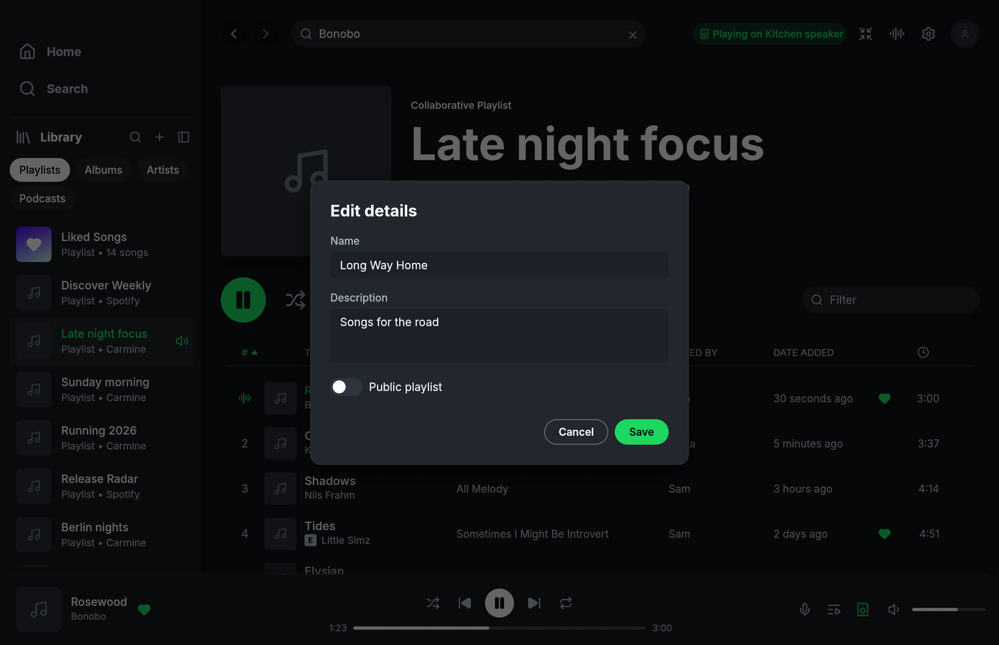
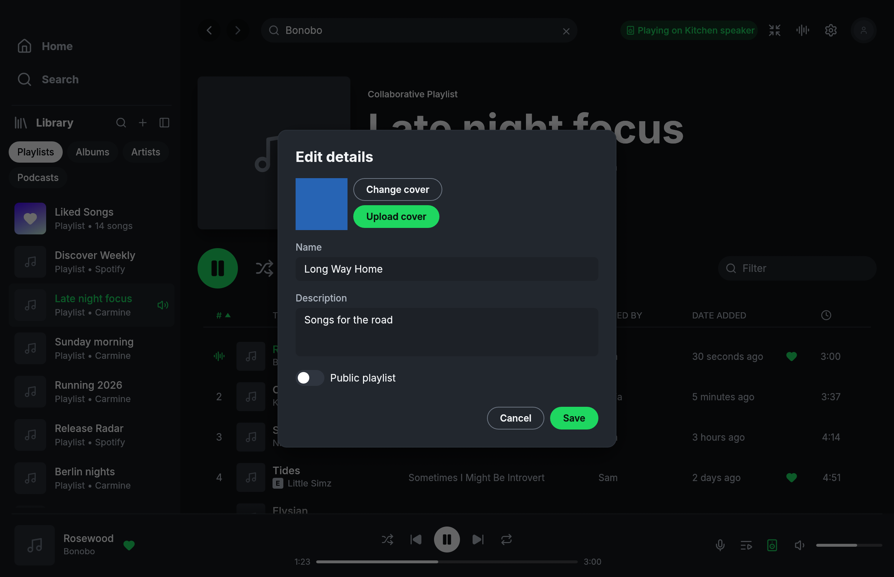
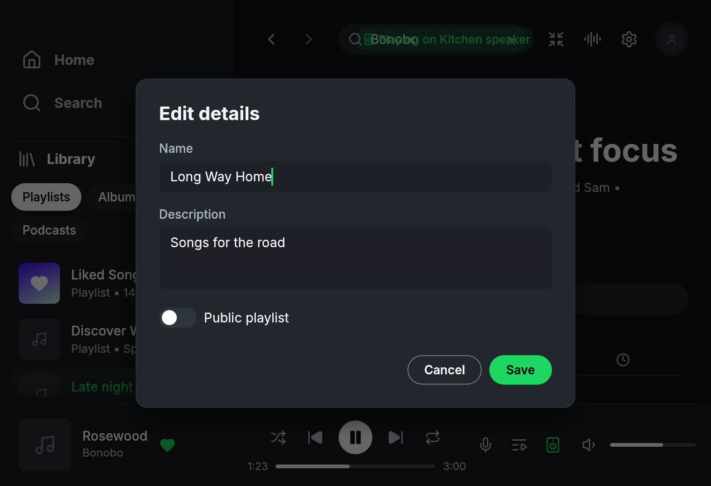
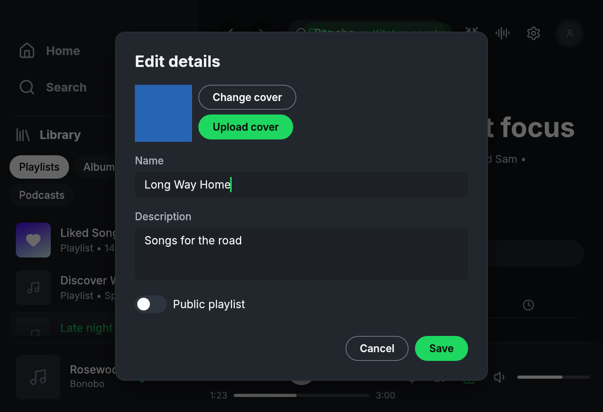
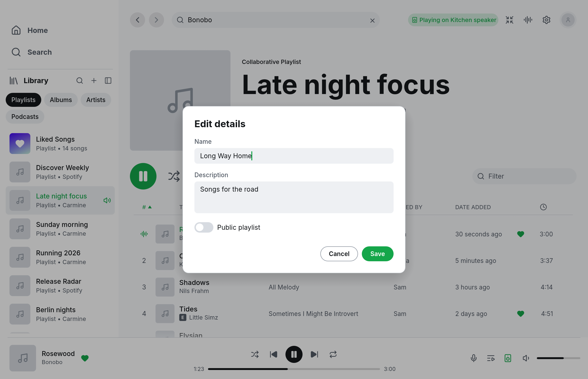
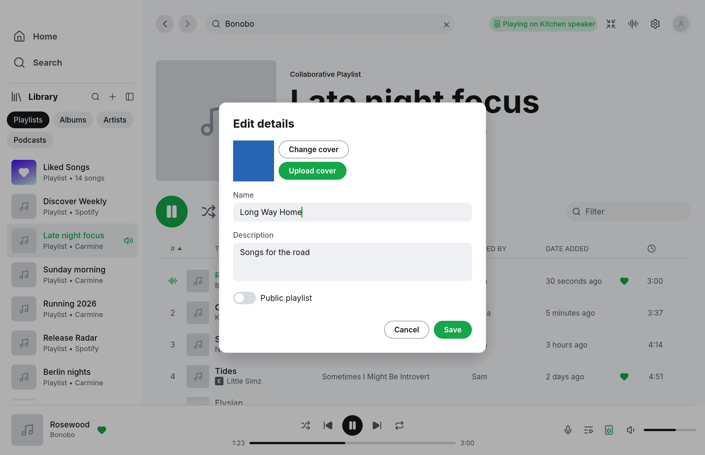
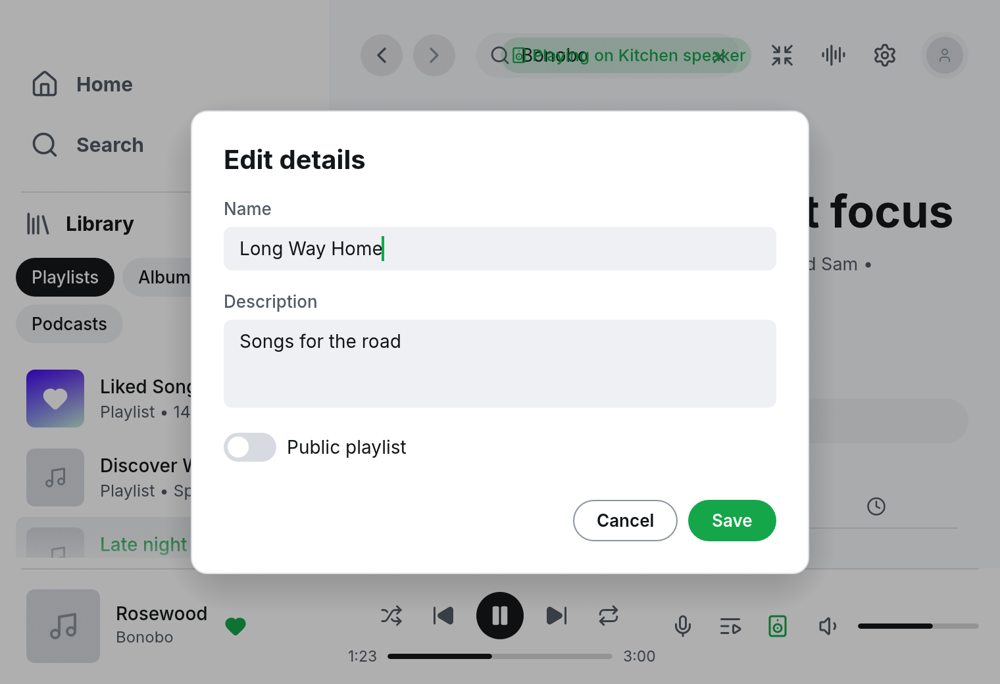
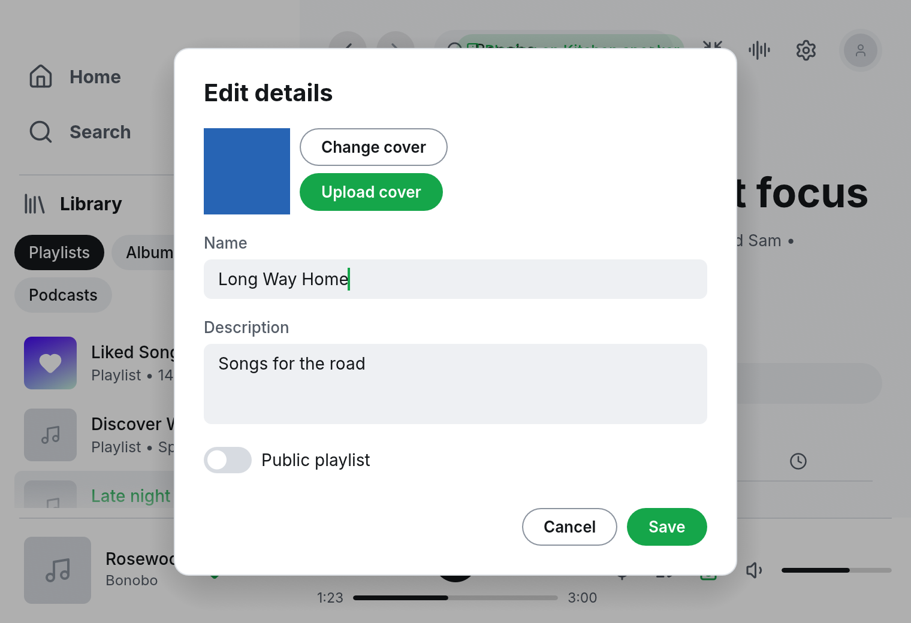

# Playlist cover upload validation

Validated on macOS Apple Silicon with Rust 1.98.0.

Implementation: 89782b5. Baseline: 3a3d7939fef2c407061d3084e4a9cb530d87f220.

All CONTRIBUTING.md checks passed:

- cargo fmt --all --check
- cargo clippy --locked --all-targets -- -D warnings
- cargo clippy --locked --all-targets --all-features -- -D warnings
- cargo test --locked --all-targets
- cargo test --locked --all-targets --all-features
- cargo test --locked --all-features --doc
- RUSTDOCFLAGS="-D warnings" cargo doc --locked --all-features --no-deps
- bundle exec jekyll build (in docs)

Both test configurations passed 345 library tests and 3 binary tests. Coverage includes bounded JPEG/PNG conversion, raw Base64 HTTP body and 202/403/413 responses, old consent, existing app routing, cancellation and stale picker events, failed uploads preserving the preview, and late metadata preserving uploaded artwork.

Native verification used the actual App and backend in an isolated macOS QA wrapper. A user-selected owned playlist was opened, its existing artwork selected in the native picker, previewed and uploaded through the shared Web API app. An authenticated GET of the playlist images returned new artwork URLs and changed JPEG bytes. The same picture was re-encoded for this test. Personal-app routing has automated coverage only. Native cancellation was not independently confirmed after the picker adjustment; cancellation state handling passed its regression test.

Linux and Windows were not compiled or run locally.

## Native demo screenshots

These are actual native eframe captures with deterministic demo data. Large windows are 1240 x 800 logical pixels; narrow windows are 760 x 520. Retina captures are twice those dimensions. After images show a selected plain blue test image before uploading. Save and Cancel remain visible at both sizes. The narrow background top-bar overlap also exists in the baseline.

| Theme and size | Before | After |
| --- | --- | --- |
| dark, large |  |  |
| dark, narrow |  |  |
| light, large |  |  |
| light, narrow |  |  |

To reproduce a capture, copy the corresponding harness to examples/cover-qa.rs in a checkout of its revision, then run:

```sh
cargo run --locked --features demo --example cover-qa -- /tmp/cover.png 1240 800 dark preview
```

Use `light` for the light theme, `760 520` for the narrow window, and omit `preview` for the baseline. The harnesses use temporary app directories and disable media controls and the tray.
